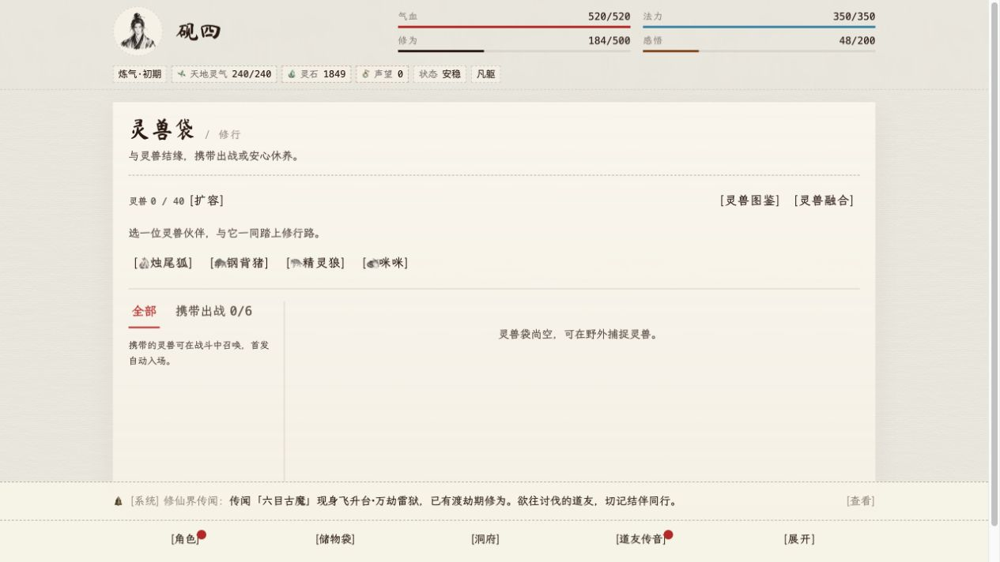

# 灵兽袋与库存管理开发验收

日期：2026-10-12。对应[设计稿](./beast-capacity-and-inventory-management-design.md)第 1、2、4、5 项，三路子代理分别负责灵兽扩容、邮件去向和库存管理；第 3 项分类界面未改。代码已实现，迁移仅在专用本地数据库应用，未部署生产。

## 实现范围

- 灵兽袋消耗现有材料和灵石逐档扩至 40／60／80／100 格。初始仍为 24 格，携带数量仍为 6；捕捉、结算、初始领取、邮件及本地发放共用角色容量。首版自动选择合格普通材料，确认层展示具体消耗。
- 邮件新物品可直入储藏室，按角色记住当前浏览器的选择。单封、批量请求冻结去向，旧背包请求和收据可重放；历史附件保留旧宝库去向。
- 背包整理合堆排格；归仓另行预览并确认，材料与低于角色当前大境界的道装入库，收藏物品跳过。储藏室分批合并同事实、同收藏状态的小堆，每批最多 200 行。
- 库存收藏贯通持久化、资源模型、发放、转存和堆叠规则。扩容、归仓、回收排除收藏，正常使用及手动转存保持原行为。
- 条件回收扫描完整来源，每批最多 200 项，支持 999 份整堆、可修改明细、下一批逐次确认和未知成交结果恢复。

迁移：[0063_beast-capacity-inventory-management.sql](../drizzle/0063_beast-capacity-inventory-management.sql)，只有容量档位／修订号、收藏标记三列及容量检查约束。生成快照只改变两张表，未修改已有列。

## 本地真实验证

使用 `env/local.env`、PostgreSQL／Redis／NATS／Mailpit、本次构建的 Nest API 和 Vite 构建产物。复用独立 local4、local5、local6 角色，没有操作当前用户角色。

| 功能 | 实际结果 |
| --- | --- |
| 扩容 | 页面完成 24→40，灵石 7849→6849，凡品妖兽材料与矿石各扣 2；收藏材料 5 份不变。容量 level／revision 均为 1，事务日志记录材料与灵石变化 |
| 扩容边界 | 预算 999 拒绝；收藏材料拒绝；同请求重放 200、`replayed=true`，改预算同键 409；后续读取无二次扣除 |
| 归仓 | 页面将 2 项普通材料入库，收藏保留；完整 40 格样本转 39 项；同键重放不再转存；预览后修改收藏／revision 整批 409 |
| 道装归仓 | 金丹角色的筑基道装选中，同属金丹道装保留；最新完整预览确认成功，改旧完整请求拒绝 |
| 整理 | 页面把普通矿石 1＋3 合为 4，减少 1 堆；仓库收藏 500＋99 合为 599，普通 17 隔离。重复整理请求不重复改写 |
| 邮件 | 单封与批量直入仓库，背包已有半堆不补；同参数重放成功，改去向 409；非法去向 400；旧单封和旧空批次请求兼容。纯货币邮件没有库存事件 |
| 实时刷新 | 同账号两个浏览器页面，一个领取样本邮件到仓库，另一个已打开的仓库无需手动刷新从 2 项变为 3 项 |
| 条件回收 | 全仓 204 项报价明确 200／剩余 4；500／999 份没有截成 99；1000 份 400；报价后收藏造成整批失效，无部分扣除 |
| 成交 | 999 份样本实际扣除并到账 12987，重放余额不再增加；200 项批次实际成交，后续资源读取与数据库一致 |
| 页面 | 桌面和 360px 库存／邮件／回收入口、明细可操作；360px 页面宽度 345，没有超出 360px 横向溢出 |

扩容后页面：

手机储藏室与回收明细：[储藏室](./assets/inventory-management/daoyou-inventory-storage-360.jpg)、[回收明细](./assets/inventory-management/daoyou-recycle-360.jpg)。

## 静态检查与纯规则测试

- `pnpm run lint`：ESLint 与 API Oxlint 均通过，无新增警告。
- `pnpm run typecheck`：8 个包及根维护工具通过。
- `pnpm run build`：8 个包通过；最后 UI 文案／稳定订阅调整后另跑 `pnpm run build:client` 通过。Vite 仍提示已有大 chunk。
- `pnpm run test`：首次暴露旧数量边界及旧库存期望，已修正。后一次并行运行的战斗平衡用例超时；降低并行后 `pnpm exec vitest run --maxWorkers=4` 全部 264 文件／2732 用例通过。
- 新增纯规则验证覆盖扩容预算与选材、收藏堆隔离、归仓大境界判断、真实条件筛选与数量边界；没有新增 API／Web 单元测试或一次性测试脚本。
- `git diff --check` 与任务文件 Prettier 通过。

## 测试环境恢复与验证范围

仅清理本轮通过正式本地 dev 入口创建的材料／道装，按精确名称及 ID 核对后恢复。三个角色最终背包和仓库都为 0 行；local6 恢复炼气初期、灵石 0，已有灵兽未动。local5 保留正常领取的新手礼包 20000 灵石；local4 撤去准备的 5000 灵石，保留真实历练收益及扩容支出，最终 1849 灵石、40 格容量。已领取样本邮件与玩法日志保留作为验收历史。

验收后停止当次启动的 API／Vite preview，恢复原有 `daoyou-local-app-1`，Docker 健康检查通过；临时登录响应和 Cookie 文件已删除。实际使用新功能需加载本次应用构建，生产发布还需应用上述迁移。

自动审批曾拒绝范围不清的批量成交和旧空批次请求；补充只读证据并限定可恢复的本轮样本后，较窄的成交与清理操作获准完成，无剩余审批阻塞。

本轮没有逐档实际解锁 60／80／100、进行野外捕获长流程或强制制造资源历史过期的 full resync；这些路径按配方纯规则、调用方和事务审查验证。高级档位成本仍为首版设计值，需要后续玩法经济测量。没有新增任务奖励或手动更换扩容堆栈的界面。
